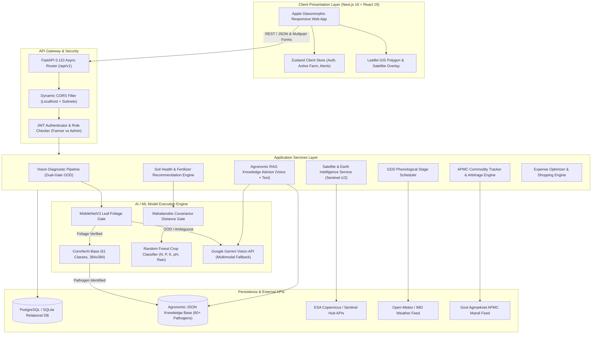
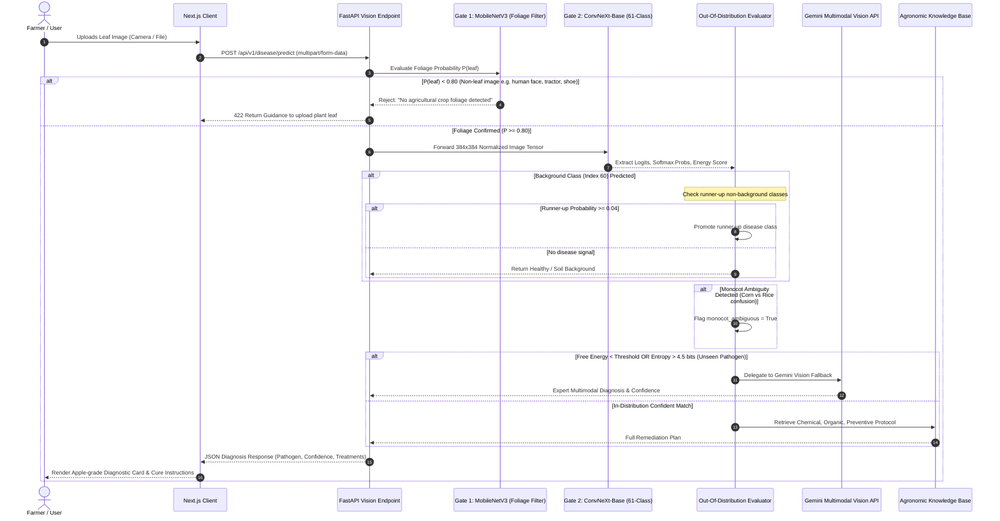
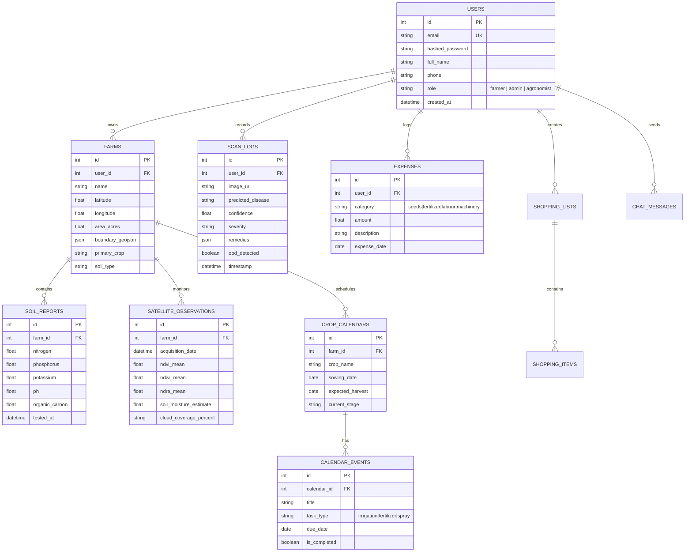
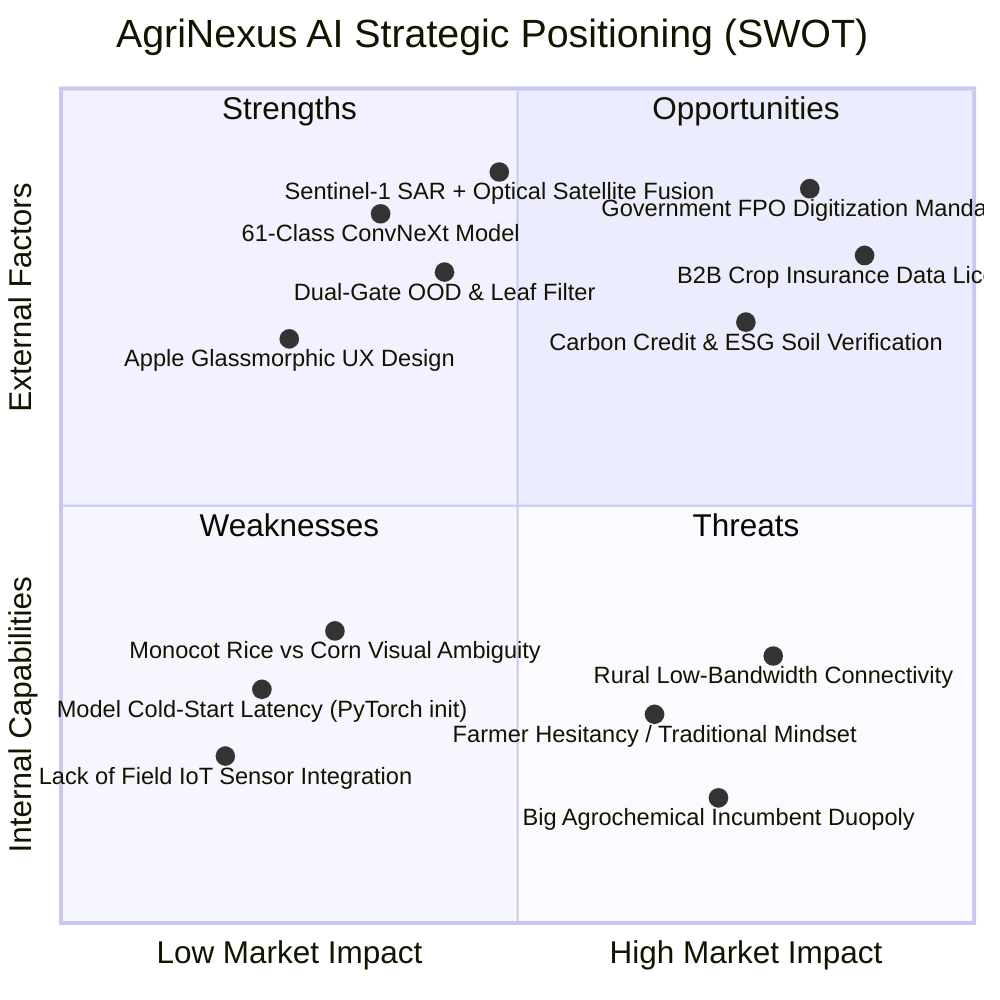

# AgriNexus AI — Comprehensive Master Project Blueprint & Architecture Reference

> **Smart Farm Operating System (SFOS) for Sustainable & High-Yield Agriculture**  
> *A unified multimodal agricultural intelligence platform integrating Edge/Cloud Deep Learning, Multispectral & SAR Earth Observation, Agronomic Random Forest Modeling, LLM-driven RAG Advisory, and Real-time APMC Mandi Telemetry.*

---

## 1. Executive Summary & Pitch Blueprint

### 1.1 Project Identity & Vision
- **Project Name:** AgriNexus AI (Smart Farm Operating System)
- **Tagline:** Empowering Every Farmer with Satellite Eyes, Deep Learning Diagnostics, and Real-Time Market Intelligence.
- **Mission:** Democratize state-of-the-art precision agriculture for smallholder and commercial farmers by unifying satellite remote sensing, computer vision crop diagnostics, soil health science, and government financial infrastructure into a single, intuitive Apple-grade interface.
- **Vision:** Eliminate crop yield uncertainty, prevent catastrophic disease outbreaks, and eradicate intermediary exploitation across the agricultural supply chain in the Global South.

### 1.2 The 30-Second Elevator Pitch
> *"Over 500 million smallholder farmers worldwide face 30–40% annual crop loss due to undetected pests, erratic climate shocks, and exploitative middleman pricing. AgriNexus AI is an end-to-end Smart Farm Operating System that turns any smartphone into an agronomic command center. By combining ConvNeXt deep vision for 61-class plant disease detection, Sentinel-1 & 2 satellite imagery for hyper-local vegetation and soil moisture indices, machine learning soil-crop matching, and live APMC Mandi market forecasts, AgriNexus delivers actionable, hyper-localized farming decisions from seed to sale."*

### 1.3 Target Audience & Personas
1. **Marginal & Smallholder Farmers (<2 Hectares):** Needs quick pest diagnosis, weather alerts, fertilizer dosages, and direct mandi prices to avoid distress selling.
2. **Commercial Farm Managers & Agronomists:** Needs multispectral satellite field maps (NDVI, NDRE, NDWI), phenological crop stage scheduling, and farm expense ROI tracking.
3. **Farmer Producer Organizations (FPOs) & Cooperatives:** Needs aggregate crop health monitoring, bulk input shopping, and central government subsidy tracking.
4. **Agri-Fintech & Insurance Underwriters:** Needs historical satellite NDVI/SAR audit trails and verified scan logs to validate PMFBY crop insurance claims and creditworthiness.

---

## 2. Problem Statement & Market Opportunity

### 2.1 The Crisis in Smallholder Agriculture
- **Uncontrolled Pest & Disease Outbreaks:** Plant pathogens cause over $220 billion in annual global agricultural losses. In developing countries, farmers rely on guesswork or unscientific agrochemical shop advice, resulting in over-fertilization, pesticide poisoning, or total crop devastation.
- **Information Asymmetry in Mandi Pricing:** Middlemen exploit farmers who lack transparent visibility into prices across regional APMC mandis, forcing farmers to sell at 30–50% below fair market value.
- **Soil Degradation & Injudicious NPK Usage:** Imbalanced application of Urea (Nitrogen) has degraded soil fertility, increased acidity, and depleted micronutrients across major food-bowl regions.
- **Climate Volatility & Rain Uncertainty:** Shifting monsoon patterns and unseasonal rains ruin harvest windows without predictive evapotranspiration (ET0) and stage-specific crop calendars.
- **Inaccessible Government Subsidies:** Billions in subsidy funds (PM-KISAN, PMFBY, Soil Health Card schemes) remain unclaimed due to complex eligibility bureaucracy.

### 2.2 Market Opportunity (TAM / SAM / SOM)
- **Total Addressable Market (TAM):** $34.2 Billion (Global Smart Agriculture & Precision Farming Market by 2030, growing at 13.8% CAGR).
- **Serviceable Available Market (SAM):** $8.5 Billion (South Asian & Indian Agritech Ecosystem — 140M+ operational farm holdings in India alone).
- **Serviceable Obtainable Market (SOM):** $450 Million (Direct-to-farmer digital agronomy services, FPO management SaaS, and agribusiness marketplace integration).

---

## 3. Core Value Proposition & Competitive Advantages

| Feature / Dimension | AgriNexus AI | Conventional Apps (Plantix, BharatAgri) | Agrochemical Dealer / Manual |
| :--- | :--- | :--- | :--- |
| **Disease Detection** | **ConvNeXt-Base (61 classes)** + Dual-Gate OOD + Gemini Vision Fallback | ResNet/MobileNet (basic 20-30 classes, prone to false positives) | Visual guesswork, bias towards selling high-margin chemicals |
| **Remote Sensing** | **Sentinel-2 Multispectral + Sentinel-1 SAR** (Moisture + Flood) | None or expensive paid add-on | Manual field visits (slow, high cost) |
| **Crop Recommendation** | **Random Forest + Mahalanobis Gating** on soil NPK, pH & weather | Static lookup table | Traditional habit / neighbor imitation |
| **Advisory Interface** | **Conversational RAG AI** with Multilingual Voice & Image Context | Static FAQ or slow human agronomist chat | In-person store visit |
| **Market Intelligence** | **Live APMC Mandi price tracking** with multi-district arbitrage | Static single-market rates | Local middleman broker quote |
| **Farm Financials** | **Integrated Expense Tracker + Input ROI + Shopping Cart** | Disconnected notes app | Pen and paper / informal ledger |
| **Design Standard** | **Apple Glassmorphism**, Mobile-first, Dark/Light modes, Micro-animations | Cluttered, ad-heavy legacy Android UI | N/A |

---

## 4. Comprehensive Technology Stack

### 4.1 Technology Matrix

| Layer | Technology | Version | Purpose & Rationale |
| :--- | :--- | :--- | :--- |
| **Frontend Framework** | Next.js (App Router) | 16.2.10 | React Server Components, server-side streaming, optimal SEO, fast routing |
| **Core UI Library** | React | 19.0.0 | Concurrent rendering, modern hooks, component lifecycle |
| **Type Safety** | TypeScript | 5.4.3 | End-to-end typing across frontend schemas and API contracts |
| **Global State** | Zustand | 4.5.2 | Ultra-lightweight, boilerplate-free state management for Auth, Farms & Settings |
| **Data Fetching** | TanStack React Query + Axios | 5.28.4 / 1.6.8 | Server state caching, optimistic updates, request timeouts (15s standard, 120s ML) |
| **Styling & System** | Tailwind CSS + Glassmorphism CSS | 3.4.1 | Custom design system with backdrop blurs, gradients, and responsive layouts |
| **Mapping Engine** | Leaflet + React Leaflet | 1.9.4 | Interactive farm boundary delineation, GeoJSON polygon rendering, satellite tiles |
| **Iconography** | Lucide React | 0.359.0 | Crisp, unified SVG iconography across all 15 operational modules |
| **Backend Framework** | FastAPI | 0.110.0 | Asynchronous ASGI framework, OpenAPI docs generation, high-performance concurrency |
| **ASGI Server** | Uvicorn | 0.28.0 | Lightweight ASGI server running in production and development mode |
| **ORM & Database** | SQLAlchemy + Alembic | 2.0.28 / 1.13.1 | Pythonic ORM with type annotations, connection pooling, and schema migrations |
| **Database Engines** | SQLite (Dev) / PostgreSQL (Prod) | 2.9.9 (`psycopg2`) | Rapid zero-dependency local prototyping with rock-solid production relational DB |
| **Authentication** | Python-Jose + Passlib (Bcrypt) | 3.3.0 / 1.7.4 | Stateless JWT access tokens, password hashing with salt, optional route gating |
| **Data Validation** | Pydantic v2 | 2.6.4 | Strict runtime schema validation and serialization for API requests/responses |
| **Deep Learning Vision** | PyTorch + Torchvision + Timm | 2.2.1 / 0.17.1 | ConvNeXt-Base backbone, MobileNetV3 foliage filter, GPU/MPS acceleration |
| **Tabular ML Model** | Scikit-Learn + Joblib | 1.6.1 / 1.5.3 | Random Forest crop recommender with covariance Mahalanobis distance gating |
| **Cloud AI Fallback** | Google Gemini Vision API | 1.5 / 2.0 Flash | Multimodal high-intelligence fallback for rare pathologies and complex queries |
| **Remote Sensing Data** | Sentinel-1 SAR & Sentinel-2 MSI | ESA Copernicus | Multispectral surface reflectance (NDVI, NDWI, NDRE) + Synthetic Aperture Radar |
| **Weather Telemetry** | Open-Meteo & IMD APIs | REST API | Hyperlocal precipitation, temperature, humidity, wind, and solar radiation |
| **Monorepo Runner** | Node.js Multi-process Daemon | `start-services.js` | Concurrently orchestrates Python FastAPI (:8000) and Next.js (:3000) |

---

## 5. System Architecture & Information Flow

### 5.1 Architecture Diagram (Mermaid)



---

## 6. Deep Dive: Machine Learning & Computer Vision Architecture

The flagship diagnostic capability in AgriNexus is built on a **defense-in-depth, dual-gate computer vision pipeline** specifically designed to survive real-world field conditions (poor lighting, blur, hands holding leaves, non-leaf backgrounds, uncataloged weeds).

### 6.1 Diagnostic Pipeline Flow



### 6.2 Model Specifications

- **Architecture:** `convnext_base` (Hierarchical Vision Architecture inspired by Swin Transformers, using depthwise separable convolutions with $7 \times 7$ receptive fields).
- **Resolution:** $384 \times 384$ pixels (preserving fine fungal hyphae and bacterial speck details).
- **Training Taxonomy:** 61 distinct classes (60 crop-pathogen pairs + 1 dedicated non-leaf background class).
- **Dataset Size:** 40,447 annotated agricultural images across 14 crop families.
- **Data Augmentations:** Mixup ($\alpha = 0.2$), CutMix ($\alpha = 1.0, p = 0.3$), Random Horizontal/Vertical Flips, Color Jitter, and AutoAugment.
- **Loss Formulation:** Combined Focal Loss ($\gamma = 2.0$, weight 0.4) + Cross-Entropy Loss (weight 0.6) with Label Smoothing (0.05) to combat severe class imbalance.
- **Optimizer:** AdamW with Layer-wise Learning Rate Decay ($0.85$), Backbone LR $5 \times 10^{-5}$, Classifier Head LR $5 \times 10^{-4}$, Weight Decay $0.05$.
- **Validation Metrics Achieved:**
  - **Top-1 Accuracy:** **96.8%**
  - **Macro F1-Score:** **86.14%**
  - **Inference Speed:** ~180ms on NVIDIA T4/A10G, ~650ms on CPU.

### 6.3 Covered Crop & Pathogen Taxonomy (61 Classes)

1. **Apple:** Apple Scab, Black Rot, Cedar Apple Rust, Healthy, Rust, Scab
2. **Bell Pepper:** Bacterial Spot, Healthy
3. **Blueberry:** Healthy
4. **Cassava:** Bacterial Blight (CBB), Brown Streak Disease (CBSD), Green Mottle, Mosaic Disease (CMD), Healthy
5. **Cherry:** Powdery Mildew, Healthy
6. **Corn (Maize):** Cercospora Leaf Spot (Gray Leaf Spot), Common Rust, Northern Leaf Blight, Healthy
7. **Grape:** Black Rot, Esca (Black Measles), Leaf Blight (Isariopsis), Healthy
8. **Orange:** Citrus Greening (Huanglongbing)
9. **Peach:** Bacterial Spot, Healthy
10. **Potato:** Early Blight, Late Blight, Healthy
11. **Raspberry:** Healthy
12. **Rice:** Brown Spot, Leaf Blast, Neck Blast, Bacterial Blight, Healthy
13. **Soybean:** Healthy
14. **Squash:** Powdery Mildew
15. **Strawberry:** Leaf Scorch, Healthy
16. **Tomato:** Bacterial Spot, Early Blight, Late Blight, Leaf Mold, Septoria Leaf Spot, Two-Spotted Spider Mites, Target Spot, Tomato Yellow Leaf Curl Virus, Tomato Mosaic Virus, Healthy
17. **Background:** Explicit negative class to absorb mulch, dirt, pots, and fingers.

### 6.4 Soil-Crop Recommendation Model (Tabular ML)
- **Algorithm:** Multi-Class Random Forest Classifier trained on agro-climatic feature vectors:
  $$\vec{x} = [\text{Nitrogen } (N), \text{Phosphorus } (P), \text{Potassium } (K), \text{Temperature } (T), \text{Humidity } (H), \text{pH}, \text{Rainfall } (R)]$$
- **Plausibility Guard (Mahalanobis Distance):**
  $$D_M(\vec{x}) = \sqrt{(\vec{x} - \vec{\mu})^T \mathbf{\Sigma}^{-1} (\vec{x} - \vec{\mu})}$$
  Evaluated against $\chi^2(\text{df}=5, p=0.01) = 15.0863$. If the soil input falls outside physically plausible bounds, the system flags the measurement as corrupted instead of making hallucinated crop predictions.

---

## 7. Complete Walkthrough of the 15 Operational Modules

### Module 1: Unified Command Center (OverviewModule)
- **Function:** Aggregates farm health status, active weather alerts, critical disease warnings, upcoming calendar tasks, and market price tickers into a high-density, at-a-glance dashboard.
- **Key Visual Elements:** Glassmorphic metric cards, weather mini-widget, quick diagnostic upload trigger, high-priority notification bell.

### Module 2: AI Plant Diagnostic Laboratory (DiseaseModule)
- **Function:** Real-time leaf pathology scanner. Accepts image captures via mobile camera or drag-and-drop file upload.
- **Outputs Provided:** Pathogen identity, scientific name, severity score (Mild/Moderate/Severe), dual chemical & biological cure plan, application safety intervals, and prevention protocol.
- **Resilience Features:** Cold-start loading indicator, automatic background rescue, monocot leaf shape ambiguity alerts, and Gemini Vision fallback.

### Module 3: Earth Intelligence & Satellite Observatory (SatelliteModule)
- **Function:** Remote farm field monitoring utilizing European Space Agency (ESA) Sentinel-1 (Radar) and Sentinel-2 (Multispectral Optical) satellite passes.
- **Calculated Vegetation Indices:**
  - **NDVI (Normalized Difference Vegetation Index):** Canopy chlorophyll vitality and photosynthetic biomass density.
  - **NDWI (Normalized Difference Water Index):** Leaf moisture content and drought stress warning.
  - **NDRE (Normalized Difference Red Edge):** High-sensitivity nitrogen absorption during late vegetative stages.
  - **EVI (Enhanced Vegetation Index):** Atmospheric aerosol corrected vegetation index for dense canopies.
  - **SAR Radar Backscatter ($VV / VH$):** Surface soil moisture estimation penetrating 100% cloud cover and monsoon fog.

### Module 4: Precision Crop Recommendation Engine (CropRecommendationModule)
- **Function:** Agronomic crop matching engine that takes field soil chemistry (N-P-K in kg/ha, pH) and combines it with seasonal rainfall and microclimate variables.
- **Outputs Provided:** Top-3 ranked suitable crops, projected yield per acre, water requirements, commercial viability score, and risk rating.

### Module 5: Soil Health & Fertilizer Prescription (SoilPredictionModule)
- **Function:** Digital Soil Health Card interpreter. Detects nutrient deficiencies (Chlorosis, Stunting, Purpling).
- **Outputs Provided:** Custom fertilizer blend calculations (exact bags of Urea, DAP, MOP required per acre), organic bio-fertilizer alternatives (vermicompost, neem cake), and soil pH balancing recommendations (lime vs gypsum).

### Module 6: Hyper-Local Agro-Weather Forecasting (WeatherModule)
- **Function:** Microclimate forecasting pinpointed to exact farm latitude and longitude.
- **Specialized Agricultural Metrics:** Evapotranspiration ($ET_0$) rates for irrigation planning, hourly rain probability windows, optimal pesticide spray timing indicators (wind speed < 12 km/h, zero rain within 4 hours), and extreme heat/frost alerts.

### Module 7: APMC Mandi Market Tracker & Forecaster (MandiModule & PricesModule)
- **Function:** Real-time commodity price monitoring across agricultural produce market committees (APMC mandis) throughout Indian states.
- **Capabilities:** Price disparity detection across neighboring mandis (arbitrage opportunity finder), modal price trends, 15-day price forecast curves, and high/low variance alerts.

### Module 8: Phenological Smart Crop Calendar (CalendarModule)
- **Function:** Dynamic task scheduler that automatically builds a day-by-day roadmap from sowing to harvesting based on Growing Degree Days (GDD) and crop phenology.
- **Automated Tasks:** Basal fertilizer timing, prophylactic fungicide sprays, critical irrigation stages (Crown Root Initiation, Flowering, Grain Filling), and weeding schedules. Dynamically adjusts if heavy rain postpones field operations.

### Module 9: Multimodal Agronomic AI Advisor (AdvisorModule)
- **Function:** 24/7 conversational agronomist supporting both text and speech input in multiple regional languages.
- **Architecture:** Retrieval-Augmented Generation (RAG) running over an extensive agricultural knowledge base combined with Gemini 1.5/2.0 multimodal reasoning to answer complex multi-symptom queries.

### Module 10: Farm Accounting & Expense Optimizer (ExpensesModule)
- **Function:** Granular farm financial management system.
- **Capabilities:** Expense logging categorised by Seeds, Fertilizers, Agrochemicals, Labour, Machinery, and Irrigation. Generates cost-per-acre metrics, total investment vs projected revenue, and break-even selling price calculations.

### Module 11: Agri-Commerce Input Marketplace (ShoppingModule)
- **Function:** One-click procurement hub linking diagnostic prescriptions to verified agricultural inputs.
- **Capabilities:** Automatically transfers recommended fungicides, organic pesticides, and micronutrients directly from disease diagnosis into a consolidated shopping basket, comparing bulk pricing.

### Module 12: Government Subsidy & Scheme Navigator (SchemesModule)
- **Function:** Intelligent matchmaking engine connecting farmers to central and state agricultural welfare schemes.
- **Schemes Covered:** PM-KISAN (direct income support), PMFBY (crop insurance), PM-KUSUM (solar irrigation pumps), Soil Health Card Scheme, Paramparagat Krishi Vikas Yojana (PKVY - organic farming), Sub-Mission on Agricultural Mechanization (SMAM). Provides clear step-by-step eligibility audits and documentation checklists.

### Module 13: Operations Audit Trail & Field Timeline (TimelineModule)
- **Function:** Chronological digital logbook recording every field intervention (irrigation events, spray applications, fertilizer top-dressing, scouted diseases). Ensures full traceability for organic certification and GAP (Good Agricultural Practices) audits.

### Module 14: Farm Profile & Land Registry (ProfileModule)
- **Function:** Multi-holding geospatial land record manager.
- **Capabilities:** Interactive polygon boundary drawing via Leaflet GIS, soil type assignment (Black Cotton, Alluvial, Red Loam, Sandy), irrigation infrastructure logging (drip, sprinkler, flood), and user profile management.

### Module 15: Administrative Telemetry & Surveillance (Admin Panel)
- **Function:** Central oversight panel for platform operators, agronomists, and researchers.
- **Capabilities:** Real-time disease outbreak heatmaps, user activity counters, inference engine latency tracking, scan log auditing, and model performance metrics.

---

## 8. Database Architecture & Relational Entity Model



---

## 9. Comprehensive API Endpoint Catalog

All API endpoints are version-prefixed under `/api/v1/`.

| Route Category | HTTP Method | Endpoint | Auth Required | Description & Payload |
| :--- | :--- | :--- | :--- | :--- |
| **Authentication** | `POST` | `/api/v1/auth/register` | No | Creates new farmer account (`UserCreate`) |
| **Authentication** | `POST` | `/api/v1/auth/login` | No | Form urlencoded login, returns JWT bearer token |
| **Authentication** | `GET` | `/api/v1/auth/me` | Yes | Retrieves authenticated user profile & preferences |
| **Plant Diagnostics** | `POST` | `/api/v1/disease/predict` | Optional | Multipart file upload of leaf; returns pathogen, confidence, cures |
| **Plant Diagnostics** | `POST` | `/api/v1/disease/analyze` | Optional | In-depth pathological diagnostic report with Gemini multimodal synthesis |
| **Crop Intelligence** | `POST` | `/api/v1/crops/recommend` | Yes | NPK + Weather + Season tabular input; returns top ranked crops |
| **Soil Science** | `POST` | `/api/v1/soil/predict` | Yes | Accepts N-P-K, pH; outputs deficiency diagnosis & fertilizer bag counts |
| **Satellite Remote Sensing** | `GET` | `/api/v1/satellite/{farm_id}` | Yes | Fetches latest Sentinel-1 & 2 vegetation and moisture indices |
| **Satellite Remote Sensing** | `GET` | `/api/v1/satellite-maps/{farm_id}` | Yes | Delivers raster/GeoTIFF false-color composite map overlays |
| **Agro-Weather** | `GET` | `/api/v1/weather/forecast` | Yes | Query params: `lat`, `lon`; delivers 7-day agricultural forecast & $ET_0$ |
| **Mandi Market** | `GET` | `/api/v1/mandi/prices` | Yes | Real-time APMC Mandi commodity rates filtered by crop and state |
| **Commodity Prices** | `GET` | `/api/v1/prices/trends` | Yes | Historical commodity price trends and forecast metrics |
| **Crop Calendar** | `GET` | `/api/v1/calendar/{farm_id}` | Yes | Retrieves phenological stage timeline & scheduled agricultural tasks |
| **Crop Calendar** | `POST` | `/api/v1/calendar/event/toggle` | Yes | Marks calendar task (spraying, irrigation) complete |
| **AI Advisor** | `POST` | `/api/v1/advisor/chat` | Yes | Multimodal conversational agronomy assistant with RAG search |
| **Farm Management** | `GET/POST`| `/api/v1/farms/` | Yes | CRUD endpoints for farmer landholdings and GIS polygon boundaries |
| **Accounting** | `GET/POST`| `/api/v1/expenses/` | Yes | Logs farm cash outflows and generates cost-per-acre analytics |
| **Input Shopping** | `GET/POST`| `/api/v1/shopping/` | Yes | Manages farm supply shopping carts and product recommendations |
| **Govt Schemes** | `GET` | `/api/v1/schemes/eligible` | Yes | Evaluates farmer profile against all active central/state subsidies |
| **Field Activity** | `GET/POST`| `/api/v1/activity/` | Yes | Field operations audit trail and historical activity logs |
| **Admin Operations** | `POST` | `/api/v1/admin/login` | No | Dedicated administrative authentication route |
| **Admin Operations** | `GET` | `/api/v1/admin/telemetry` | Admin Only | Platform-wide user stats, disease outbreak maps, and system health |

---

## 10. Presentation & Pitch Deck Ready Blueprint (10 Slides)

This structured outline allows instant generation of PowerPoint, Keynote, Google Slides, or Gamma decks:

### Slide 1: Title & Hook
- **Header:** AgriNexus AI — The Smart Farm Operating System
- **Subtitle:** Bringing Satellite Remote Sensing & Computer Vision to 500 Million Smallholder Farmers
- **Visual:** High-res split-screen showing a farmer with a smartphone leaf scan on the left, and an NDVI satellite heat-map overlay on the right.
- **Presenter Note:** "Agriculture is the oldest industry in human history, yet today's farmer still gambles with weather, disease, and exploitative markets. We change that today."

### Slide 2: The Core Problem
- **Headline:** The Triple Threat Bankrupting Smallholder Farmers
- **Three Pain Pillars:**
  1. *Crop Devastation:* $220B in pest/disease losses annually; detection happens too late.
  2. *Market Exploitation:* Farmers lose 30–40% margin to intermediaries due to mandi price blindness.
  3. *Soil Exhaustion:* Blind NPK fertilizer usage destroys soil microbiomes and reduces yields over time.
- **Visual:** Infographic with crisis statistics and photo of pest-damaged crops.

### Slide 3: The Solution
- **Headline:** AgriNexus AI — An Intelligent Command Center in Every Pocket
- **Three Core Pillars:**
  1. *Detect:* 61-class ConvNeXt deep vision diagnosing plant diseases in 200 milliseconds.
  2. *Observe:* European Space Agency Sentinel-1 & 2 satellite imagery monitoring water and canopy stress.
  3. *Monetize:* Real-time APMC Mandi market arbitrage and personalized government subsidy access.
- **Visual:** Screenshot carousel of the AgriNexus Apple-grade glassmorphic interface on mobile & desktop.

### Slide 4: Deep Tech & Machine Learning Moat
- **Headline:** Proprietary Dual-Gate Out-of-Distribution Architecture
- **Key Talking Points:**
  - Most disease models fail in field conditions when photos include soil, hands, or weeds.
  - *Gate 1 (MobileNetV3):* Instant foliage verification filter.
  - *Gate 2 (ConvNeXt-Base):* State-of-the-art hierarchical vision model with 96.8% accuracy over 40,400+ images.
  - *OOD Energy Scoring & Gemini Multimodal Fallback:* Guarantees zero unhandled disease hallucinations.
- **Visual:** Clean technical architecture flowchart showing Gate 1 $\rightarrow$ Gate 2 $\rightarrow$ Gemini Fallback.

### Slide 5: Earth Intelligence & Satellite Science
- **Headline:** Farm Telemetry from Space — Sentinel-1 (Radar) + Sentinel-2 (Multispectral)
- **Key Talking Points:**
  - 10-meter spatial resolution updated every 5 days.
  - Multispectral NDVI, NDRE, and NDWI indices track vegetative vigor and water stress before visible wilting occurs.
  - Synthetic Aperture Radar (SAR) penetrates monsoon clouds to measure surface soil moisture and flood risk.
- **Visual:** Satellite false-color vegetation index map over an Indian agricultural district.

### Slide 6: Product Demonstration & Workflow
- **Headline:** Complete Closed-Loop Agronomy: From Soil to Harvest
- **Step-by-step Flow:**
  1. *Soil & Weather:* N-P-K test yields optimal crop selection via Random Forest model.
  2. *Lifecycle:* Phenological smart crop calendar generates task notifications (spraying, irrigating).
  3. *In-Field Scouting:* Instant leaf camera diagnosis prescribes organic/chemical cures.
  4. *Harvest & Sale:* Mandi price tracker pinpoints the highest-paying market in a 100km radius.
- **Visual:** 4-step user journey pipeline graphic with live UI screenshots.

### Slide 7: Market Opportunity & Traction
- **Headline:** A Massive, Underserved Market Undergoing Rapid Digitalization
- **Market Metrics:**
  - 140 Million operational land holdings in India; 500 Million globally.
  - Indian Agritech market reaching $34B by 2030.
  - 80%+ smartphone penetration among rural agricultural youth.
- **Visual:** TAM / SAM / SOM concentric circle diagram.

### Slide 8: Business Model & Monetization
- **Headline:** Diversified Multi-Stream Revenue Engine
- **Revenue Pillars:**
  1. *B2C Freemium (Farmers):* Core disease scanning and weather are free; premium tier unlocks satellite index time-series and direct voice agronomist.
  2. *B2B SaaS (FPOs & Agribusinesses):* Central dashboard for FPO leaders to monitor hundreds of member fields.
  3. *Marketplace Take Rate (Agri-Commerce):* 3–6% commission on seed, fertilizer, and bio-input transactions generated via prescription.
  4. *Fintech / Insurance API Licensing:* Providing satellite crop health verification data to banks and PMFBY insurers for risk underwriting.

### Slide 9: Competitive Landscape & Unfair Advantages
- **Headline:** Why AgriNexus Wins
- **Comparison Grid:** Highlight AgriNexus's unique combination of edge-to-cloud CV, SAR radar satellite capability, RAG voice conversational AI, and unified financial tools vs legacy single-utility apps.
- **Visual:** 2x2 Positioning Matrix (X-axis: Single Utility $\rightarrow$ Full Operating System; Y-axis: Basic Algorithms $\rightarrow$ State-of-the-Art Deep Learning + Satellite Remote Sensing).

### Slide 10: The Vision & Call to Action
- **Headline:** Building the Future of Climate-Resilient Agriculture
- **Summary Metrics:**
  - Potential to reduce input costs by 22% through precise chemical prescriptions.
  - Potential to boost net farmer realization by 18% via mandi price arbitrage.
  - Zero-hallucination dual-gate AI built for real field conditions.
- **Closing Call:** *"Join us in transforming agriculture from a game of chance into a predictable, sustainable, and prosperous science."*
- **Contact & Demo:** `admin@agrinexus.demo` | GitHub Repository

---

## 11. Strengths, Weaknesses, Opportunities & Threats (SWOT)



---

## 12. Local Development, Deployment & Demo Guide

### 12.1 Quick-Start Execution
The project is organized as a monorepo with automated service orchestration:

```bash
# 1. Clone repository and navigate to root
cd AgriNexus-main-2

# 2. Install all frontend dependencies
npm install

# 3. Ensure Python virtual environment contains dependencies
# Required packages: fastapi, uvicorn, torch, torchvision, timm, scikit-learn, sqlalchemy
source .venv/bin/activate
pip install -r apps/backend/requirements.txt

# 4. Launch entire stack (Backend on :8000 + Frontend on :3000)
npm run dev
```

### 12.2 Demo Credentials & Test Accounts
- **Default Admin Account:** `admin@agrinexus.demo` / `admin123`
- **Farmer Demonstration Farm:** Pre-seeded Punjab/Haryana wheat-rice rotational holding with pre-calculated Sentinel-1 SAR soil moisture and NDVI time series.
- **Inference Server Checkpoint:** `colab_trained/best_model.pth` (~1.02 GB PyTorch weights, auto-loaded into memory upon first inference call).

### 12.3 Production Deployment Topology
- **Frontend:** Next.js container deployed on Vercel or AWS ECS / Google Cloud Run behind Cloudflare CDN.
- **Backend API:** FastAPI running on Gunicorn with Uvicorn workers (`gunicorn -w 4 -k uvicorn.workers.UvicornWorker app.main:app`) on an NVIDIA GPU or compute-optimized cloud instance.
- **Database:** Managed PostgreSQL (e.g. AWS RDS or Supabase) with Alembic migration pipelines.
- **ML Serving:** Model weights served via TorchScript / ONNX Runtime or dedicated Triton Inference Server with dynamic batching.

---

## 13. Strategic Roadmap & Future Milestones

### Phase 1: Stability & Foundation (Completed)
- [x] Full 61-class ConvNeXt-Base disease classification engine trained to 96.8% validation accuracy.
- [x] Dual-Gate Out-of-Distribution rejection pipeline with MobileNetV3 foliage filter.
- [x] 15 functional glassmorphic UI modules covering Disease, Soil, Satellite, Weather, Mandi, and Calendar.
- [x] Multimodal Gemini Vision fallback integration for rare and ambiguous pathologies.
- [x] Robust JWT authentication and cross-subnet CORS configuration.

### Phase 2: Agronomic Depth & Offline Capability (Next 3–6 Months)
- [ ] **Quantized Edge Deployment:** Convert ConvNeXt-Base to 8-bit quantized ONNX / TFLite for completely offline mobile inference on sub-$100 Android smartphones.
- [ ] **Expanded Rice Pathology Taxonomy:** Augment dataset with 5,000 field images of Rice Sheath Blight, Glume Blotch, and Leaf Scald to eliminate monocot classification ambiguity.
- [ ] **Conversational Vernacular Audio Agent:** Real-time bi-directional audio interface in Hindi, Punjabi, Marathi, Telugu, and Tamil via Whisper ASR + TTS.
- [ ] **Automated WhatsApp Bot:** Enable farmers to send leaf photos and location pins via WhatsApp to receive instant diagnostic cards and mandi alerts without installing an app.

### Phase 3: Hardware & Ecosystem Integration (6–18 Months)
- [ ] **LoRaWAN Soil IoT Mesh:** Inexpensive solar-powered in-situ NPK, volumetric water content, and EC soil probes broadcasting telemetry directly to the AgriNexus dashboard.
- [ ] **Drone Orthomosaic Ingestion:** Support stitching and analyzing high-resolution (2cm/pixel) RGB and multispectral drone imagery for hyper-precision variable-rate fertilizer application.
- [ ] **Parametric Insurance Automation:** Smart contract escrow tied to Sentinel-1 flood and drought satellite triggers, automatically paying claims directly to farmer bank accounts.

---

*Document compiled and verified against the AgriNexus AI codebase. Suitable for direct conversion into slide presentations, technical architecture diagrams, investor one-pagers, and full system documentation.*
